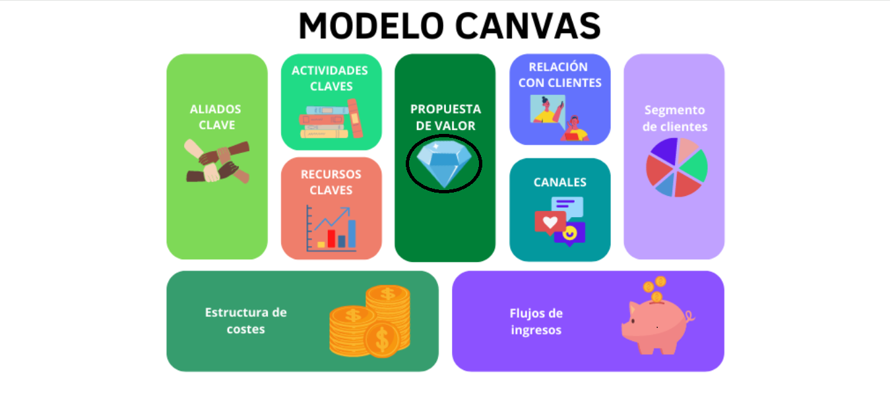
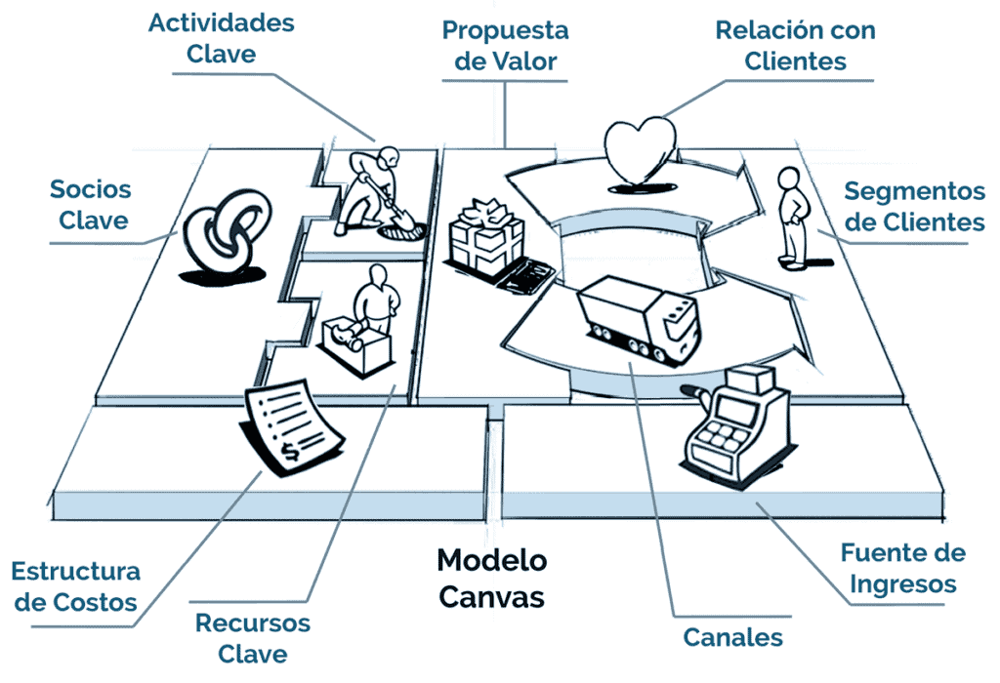

<!-- prettier-ignore -->
<div align="center">
  

  # Modelo Canvas

  **Sitio web estático e interactivo para recorrer los nueve bloques del Modelo Canvas.**

  [](https://modelocanvas.vercel.app/)
  [](https://github.com/JhoamSebastianMunoz/model-canvas)
  
  
  

  [Demo](#demo) • [Los nueve bloques](#los-nueve-bloques) • [Uso](#uso) • [Estructura](#estructura-del-proyecto) • [Estilos](#estilos) • [Despliegue](#despliegue)
</div>

**Modelo Canvas** presenta el lienzo de modelo de negocio como una experiencia navegable: la portada muestra los nueve bloques clicables y cada bloque abre una página propia con su descripción y una ilustración. El proyecto nació como un trabajo académico para el programa de **Análisis y Desarrollo de Software (ADSO)** y toma como caso de estudio una aplicación de preventa para distribuidoras y graneros.

No hay build, frameworks ni dependencias: es HTML y CSS que se abre directamente en el navegador.

> [!TIP]
> Puedes verlo sin instalar nada en **<https://modelocanvas.vercel.app/>**.

## Demo

El proyecto está desplegado en Vercel como sitio estático:

<https://modelocanvas.vercel.app/>



## Los nueve bloques

| # | Bloque | Página |
| :-: | --- | --- |
| 1 | Segmentos de clientes | [`paso_1.html`](paso_1.html) |
| 2 | Propuesta de valor | [`paso_2.html`](paso_2.html) |
| 3 | Canales de distribución y comunicaciones | [`paso_3.html`](paso_3.html) |
| 4 | Relación con el cliente | [`paso_4.html`](paso_4.html) |
| 5 | Flujos de ingreso | [`paso_5.html`](paso_5.html) |
| 6 | Recursos clave | [`paso_6.html`](paso_6.html) |
| 7 | Actividades clave | [`paso_7.html`](paso_7.html) |
| 8 | Red de partners | [`paso_8.html`](paso_8.html) |
| 9 | Estructura de costos | [`paso_9.html`](paso_9.html) |

Cada bloque tiene un color propio, tomado del lienzo, que se reutiliza en el índice de la portada y en la cabecera de su página.

## Uso

### En línea

Abre <https://modelocanvas.vercel.app/> y toca cualquier bloque del lienzo.

### En local

Clona el repositorio y abre la portada en el navegador:

```bash
git clone https://github.com/JhoamSebastianMunoz/model-canvas.git
```

```powershell
Start-Process "index.html"
```

Opcionalmente, puedes servirlo con cualquier servidor estático:

```bash
python -m http.server 8080
```

> [!NOTE]
> No se requiere instalar dependencias ni ejecutar un build. El sitio funciona abriendo `index.html` directamente.

## Estructura del proyecto

```
model-canvas/
├── index.html      # Portada con el lienzo interactivo y el índice de bloques
├── paso_1.html     # Segmentos de clientes
├── paso_2.html     # Propuesta de valor
├── paso_3.html     # Canales de distribución y comunicaciones
├── paso_4.html     # Relación con el cliente
├── paso_5.html     # Flujos de ingreso
├── paso_6.html     # Recursos clave
├── paso_7.html     # Actividades clave
├── paso_8.html     # Red de partners
├── paso_9.html     # Estructura de costos
├── style.css       # Hoja de estilos del sitio
└── img/            # Lienzo e ilustraciones de cada bloque
```

## Estilos

Todo el sistema vive en `style.css`, organizado por secciones (variables, base, portada, ficha, pie y móvil). No usa fuentes ni librerías externas.

- **Paleta:** fondo cálido plano `#fbf4e6`, texto `#2b2620`, acento dorado `#b5810e` y acento vino `#6b2a2a`.
- **Tipografía:** pila del sistema (`system-ui, "Segoe UI", …`) con escala modular y una medida de lectura de 68 caracteres.
- **Bloques:** los nueve colores del lienzo están expuestos como variables `--b1` … `--b9` y dan identidad visual a cada página.
- **Navegación:** cada `paso_N.html` comparte el mismo diseño, con barra de regreso, figura, texto y enlaces anterior/siguiente.
- **Accesibilidad:** mapa de imagen con áreas rectangulares y texto alternativo, foco visible para teclado y respeto por `prefers-reduced-motion`.

## Despliegue

El sitio se publica como proyecto estático en **Vercel** a partir de la rama `main`. Al no tener paso de compilación, Vercel sirve los archivos tal cual. La URL de producción es:

<https://modelocanvas.vercel.app/>

## Autores

Jhoam Sebastian Muñoz B, Gisela Rivera, Maria Camila Uribe, Cristian Camilo Muñoz B, Estefania Nieto y Christian Zambrano. Todos los derechos reservados.
